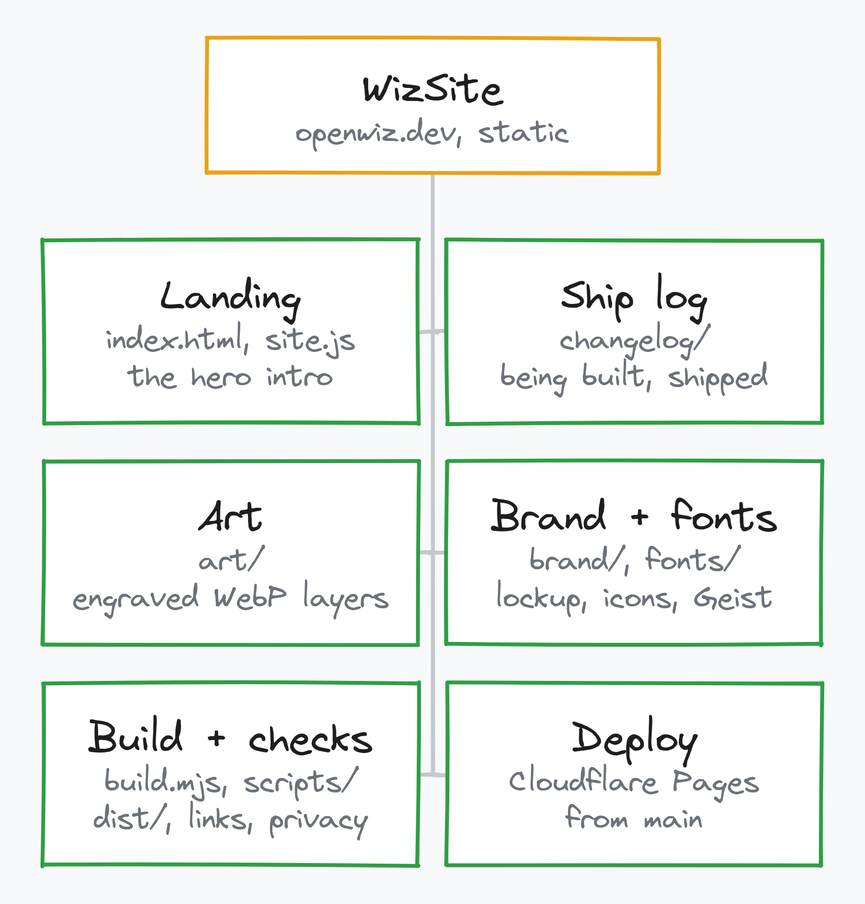

# WizSite

The standalone static site for [OpenWiz](https://github.com/openwizdev/openwiz), with a landing page and `/changelog`. It uses local fonts and a vendored GSAP build, with no runtime server. The app's one npm runtime dependency is listed below.

## Map

<picture>
  <source media="(max-width: 600px)" srcset="docs/map-phone.png">
  
</picture>

WizSite is the factory's site, openwiz.dev. The [org map](https://github.com/openwizdev) shows how it fits with the other repos.

## Build and check

Use Node.js 24, Python 3.11+ and Git. Install the pinned dependencies with `npm ci` first. The static build uses the checked-in GSAP file. The npm lockfile pins its upstream version so maintainers can verify or refresh the bundle with `npm ci --ignore-scripts`.

```sh
npm ci
npm run build
npm run check
npm test
```

`npm run build` copies the public runtime files (pages, fingerprinted styles and scripts, fonts, approved artwork, the sample spec video, vendor licences and the logo files) into `dist/`. The checks require that build first. `npm run check` checks JavaScript syntax, exact build contents, local links and fragments, HTML/CSS resources, font signatures and OFL licences, landing copy, the Changelog (its name, picture, parts and reviewed content), and private markers. `npm test` exercises those gates with synthetic broken links, missing resources and private markers.

To preview locally:

```sh
python3 -m http.server 8800 --bind 127.0.0.1 --directory dist
```

## Cloudflare Pages

Cloudflare Pages deploys from **main**. Configure the repository root as the build root, `npm run build` as the build command, and `dist` as the output directory. Both `/changelog` and `/changelog/` must resolve to `changelog/index.html`.

Changes merge after green CI and one review from the other model family. No per-change maintainer approval is required. This repository contains no deployment credentials or separate deploy workflow; the Pages project owns the Git integration.

## The Changelog's releases

Nobody writes the Changelog's release entries by hand. At every build, `scripts/changelog.mjs` reads the published releases of the three versioned repositories (OpenWiz, WizSkills and WizLoops) from GitHub's public API, unauthenticated, and `build.mjs` adds them to `/changelog/` as a *Releases* section after *What exists today*. It holds one part per repository, in that order. Each part lists every published release from 0.1.0 on, patches included, newest first by version. Each entry shows that release's own notes. WizSkills' notes are its Changesets notes. Drafts, pre-releases and releases before 0.1.0 stay on GitHub.

- **OpenWiz entries list the versions they ship with,** read from a `**Ships with**` line in that release's notes and the list items under it (for example `- WizSkills 0.1.2`). An OpenWiz release whose notes have no such list says so.
- **A part with no release from 0.1.0 on** says "No release yet".
- **A failed read** says the part is missing: a network error, a non-200 answer, an answer that isn't a list of releases, or a published release whose tag isn't a plain version such as `v1.2.3`. The build never fails on it and never shows an empty history.
- **Notes are text.** They are escaped. Code and bold keep their look, and links keep only their words.

The generator's tests (`scripts/test_changelog.py`, run by `npm test`) use the synthetic release lists in `scripts/changelog-fixtures/`. To see the section a fixture case produces, run `node scripts/changelog.mjs --fixtures scripts/changelog-fixtures/full`.

### Owner step: rebuild on each release

A release can trigger a rebuild through a Cloudflare Pages deploy hook. This repository doesn't configure one. Setting it up is the owner's step, once the first versioned release ships:

1. In the Cloudflare dashboard, open the WizSite Pages project, then **Settings → Builds → Deploy hooks**. Add a hook named `release` for the `main` branch, and copy its URL. The URL is a secret: anyone who has it can start a build.
2. In each releasing repository (OpenWiz, WizSkills and WizLoops), add the URL as an Actions secret named `WIZSITE_DEPLOY_HOOK`.
3. In each of them, add a workflow that posts to the hook when a release is published:

   ```yaml
   name: Rebuild openwiz.dev
   on:
     release:
       types: [published]
   permissions: {}
   jobs:
     rebuild:
       runs-on: ubuntu-latest
       steps:
         - run: curl -fsS -X POST "$HOOK"
           env:
             HOOK: ${{ secrets.WIZSITE_DEPLOY_HOOK }}
   ```

4. Publish a release, or re-run the workflow, and check that a new production deployment starts in Pages and that `/changelog/` lists the release.

Without the hook, the Changelog changes only when WizSite itself next deploys.

## Site assets

WizSite owns `tokens.css`. The landing page and the Changelog use it with `site.css`; the Changelog keeps its own styles inline in `changelog/index.html`, so the landing never loads them. The landing also loads the pinned GSAP 3.15.1 core and `site.js`. The build fingerprints these styles and scripts so new HTML gets the matching assets. The GreenSock Standard No Charge licence and the agent icon notices ship in `vendor/`.

The landing page opens on an Ember-style OpenWiz window that walks through one to-do build. Painted WebP costume and crew sprites sit alongside HTML ticket states and the builder Wiz on the ticket being built. Below it are the supported agent logos and three product moments. The spec card describes steering the build from a narrated video and includes a labeled silent sample that loads on request. The footer's twelve waving Wizes (the middle six, in one row, on phones) look toward the pointer and react briefly, one at a time: hovering the footer perks up the nearest, the one under the pointer waves, and a click or Enter plays its own short move (the cave and samurai Wizes use the hero's work frames, and now and then one poofs into another costume) with a tiny line that fades. With reduced motion, Pause motion or no GSAP, a click is a still costume change and the line only. At rest the footer is unchanged. The demo pauses off screen, offers a Pause motion control and keeps a readable still when reduced motion is on or either script is unavailable. The OpenWiz install button stays disabled as **Install · coming soon**. Sign in and the phone home-screen instructions lead to the existing app.

`/changelog` is the **Changelog**. A small picture of how the public repositories fit together opens it, then one *What exists today* section: one part per public repository, each opening with two or three plain sentences, then what a person can use now, written from merged code. Private repositories appear only as "private records and tools". *What exists today* holds no release entries, version numbers or dates. After it, the build adds a generated *Releases* section; see below.

The logo files carry the OpenWiz mark in dark cream (`#cfc6b8`) on the site ground (`#1b1916`): the favicons (`favicon.ico` with 16, 32 and 48 px images, `favicon.svg`, `apple-touch-icon.png`, each the mark on a dark tile), the header lockup `brand/openwiz-lockup.svg` and the 1200×630 social card `brand/og.png` (the lockup on the site ground, rendered from the SVG). The check refuses a vector logo without the dark cream or still in the earlier blue mark. The lockup's wordmark is converted to outlines: the SVG has no text and no font reference, and the check refuses one that does, so the wordmark font never ships.

The README's map (`docs/map.png`, and `docs/map-phone.png` for narrow screens) is for GitHub only: the build never copies it, and the check pins both by hash in `DOC_HASHES` like the icons. Its source is `maps/draw.mjs` in `openwizdev/.github`.

The Geist and Geist Mono fonts ship unmodified with `fonts/OFL.txt`. Keep the licence in source and the static export. The build does not fetch fonts from an external service.

## Privacy and verification limits

CI uses only Node.js, Python's standard library, Git and the checkout/setup Actions, plus `npm ci` for the pinned dependencies below; it builds the landing from the checked-in vendor files.

**npm dependencies** (exact versions in `package.json`, locked in `package-lock.json`; small, maintained and licence-checked, under J187):

| Package | Version | Licence | Size | Why |
| --- | --- | --- | --- | --- |
| `@dagrejs/dagre` (with `@dagrejs/graphlib` 4.0.6, bundled in its file) | 3.1.3 | MIT | 49 KB minified | Lays out a spec's ticket graph in the app: layered, with fewer crossings and routed arrows. The build copies `dist/dagre.min.js` and its `LICENSE` into `dist/app/vendor/`; it makes no network calls |

`scripts/check.py` documents a small case-insensitive denylist of generic private-repository names, owner-home paths, private evidence/decision paths and thread identifiers. It scans tracked and non-ignored source paths and UTF-8 contents, plus the export. Only the denylist declaration itself is exempt from matching its own literals. Bundled font binaries and licences are pinned by hash; each `art/*.webp` must be plain WebP with no EXIF or XMP chunks, and the pinned artwork and spec video share a 2 MB budget; the PNG and ICO logo files are pinned by hash; other binary content and symlinks require review. Personal literal lists and private policy/history tooling are deliberately not copied into this public repository.

This denylist is a tripwire, not comprehensive detection of private names or secrets. Independent review must also assess privacy and unsettled claims. External link destinations are constrained to the three public repositories; CI does not make network availability checks or validate remote fragments.

**Named gap — automated browser tests:** layout/overflow, keyboard and touch navigation, accessibility/contrast and animation/reduced-motion behavior are not covered by CI. The browser smoke check requires no additional project dependency; the app's own browser check (`npm run test:app`) covers its pages and their keyboard path. A browser smoke check is useful evidence but does not close this automated-test gap.

## Sign-in

openwiz.dev/app signs in through the read-only [OpenWiz Viewer](https://github.com/apps/openwiz-viewer) GitHub App (issues, pull requests and metadata, read only). Its client ID and secret live only in the Cloudflare Pages project settings.
